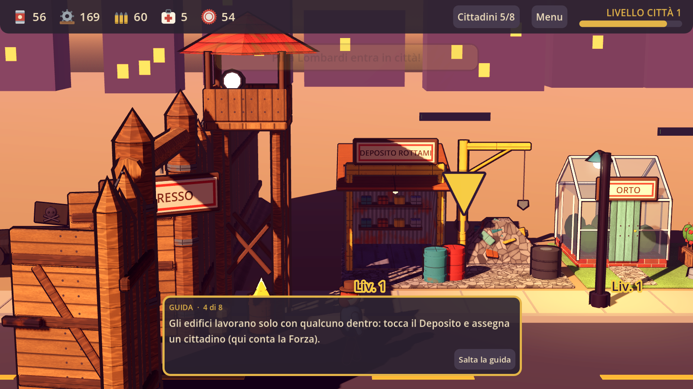

# Rifugio

Un gestionale di sopravvivenza in 3D low-poly, erede spirituale di *No Zombies Allowed* con un pizzico di *Fallout Shelter*. Costruisci una città lungo una strada, accogli i sopravvissuti che bussano al cancello, assegna ognuno al lavoro giusto e manda le squadre a liberare le zone infestate dagli zombie.

Fatto con **Godot 4.7** (renderer Compatibility), pensato prima di tutto per il **browser** e il telefono in orizzontale.



## Cosa c'è già

- Città a lotti: 15 edifici, ognuno con 3 livelli e un modello per livello.
- Cittadini con Forza, Agilità, Intelligenza e Carisma, tratti, rarità, umore, esperienza.
- Produzione e raccolta, anche a gioco chiuso.
- Cancello chiuso con custode che decide chi entra; mura a 3 livelli.
- Battaglie fuori dalle mura (tiro automatico + tocchi), attacchi alla città, Ambulatorio per curare gli zombie catturati.
- Officina con armi e vestiti, Radio per gli appelli, Palestra, Biblioteca e Teatro per allenarsi.
- Guida per la prima partita, effetti sonori e musica sintetizzati, salvataggio automatico.

## Come provarlo

1. Installa [Godot 4.7](https://godotengine.org/download).
2. Apri la cartella `gioco/` (il file `project.godot`) e premi **F5**.

Per la versione browser: Progetto > Esporta > Web (servono i modelli di esportazione di Godot), poi servi la cartella `build/web` con un server qualsiasi, per esempio `python3 -m http.server`.

Tutti i dettagli su regole, numeri e tappe di sviluppo sono in [`gioco/LEGGIMI.md`](gioco/LEGGIMI.md).

## Com'è organizzato

```
gioco/      il progetto Godot
  script/     tutta la logica (GDScript): stato_gioco.gd, bilanciamento.gd, interfaccia.gd, battaglia.gd…
  assets/     modelli .glb, texture, icone, suoni, font
  strumenti/  vetrina dei modelli e generatore dei suoni
blender/    script Python che generano tutti i modelli 3D e le texture
```

I modelli non sono fatti a mano: li genera `blender/crea_modelli.py`, dentro Blender oppure con Python puro (serve solo numpy):

```
cd blender
python3 crea_modelli.py --uscita ../gioco/assets/modelli
```

Tutti i numeri del gioco (costi, tempi, vita degli zombie…) sono in `gioco/script/bilanciamento.gd`.

## Vuoi aiutare?

Benvenuto! Le cose più utili adesso:

- **Giocarlo e dire cosa non va**: apri una *Issue* con cosa hai fatto, cosa ti aspettavi e cosa è successo (uno screenshot aiuta).
- **Bilanciamento**: troppo facile, troppo difficile, troppo lento? Proposte concrete sui numeri di `bilanciamento.gd`.
- **Modelli e grafica**: nuovi edifici o varianti negli script di `blender/`.
- **Codice**: correzioni e nuove funzioni con una *Pull Request*. Il codice è scritto in italiano (nomi di variabili e commenti): manteniamolo così.

Prima di lavorare a qualcosa di grosso, apri una Issue per parlarne.

## In English

*Rifugio* is a low-poly 3D survival city builder inspired by *No Zombies Allowed* and *Fallout Shelter*, made with Godot 4.7 for the browser. Code and comments are in Italian. Issues and pull requests are welcome, in English too.

## Crediti

Ideato da Francesco. Modelli, suoni e musica sono generati dagli script del progetto; nessun asset dei giochi originali è incluso. Font: DejaVu Sans (vedi `gioco/assets/font/LICENZA_DejaVu.txt`).
